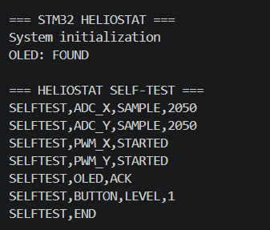
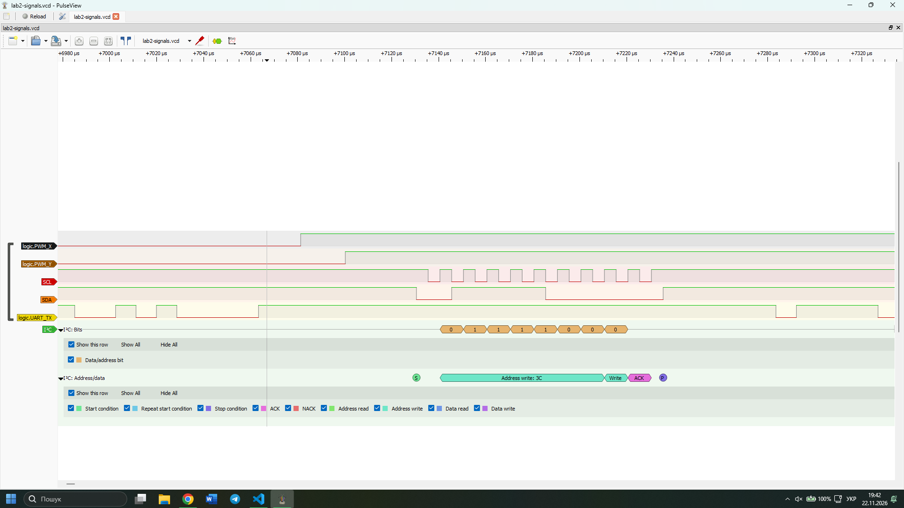
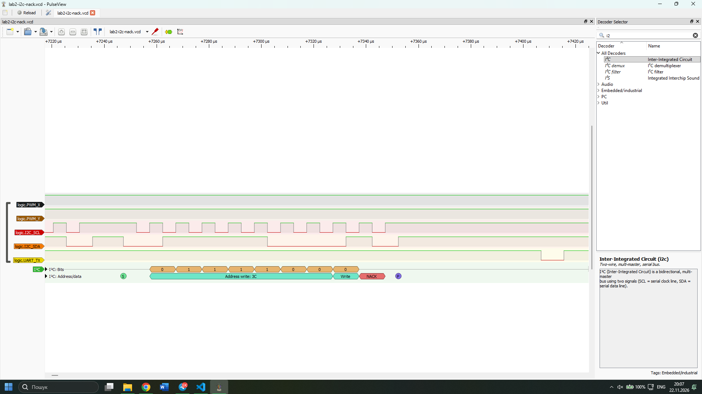
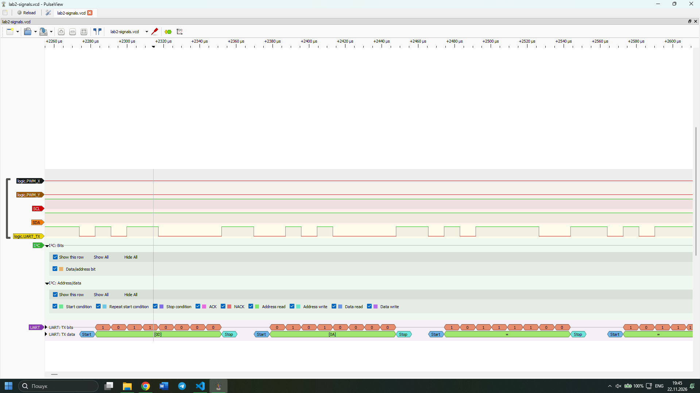
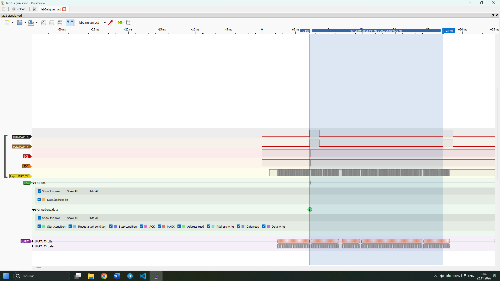
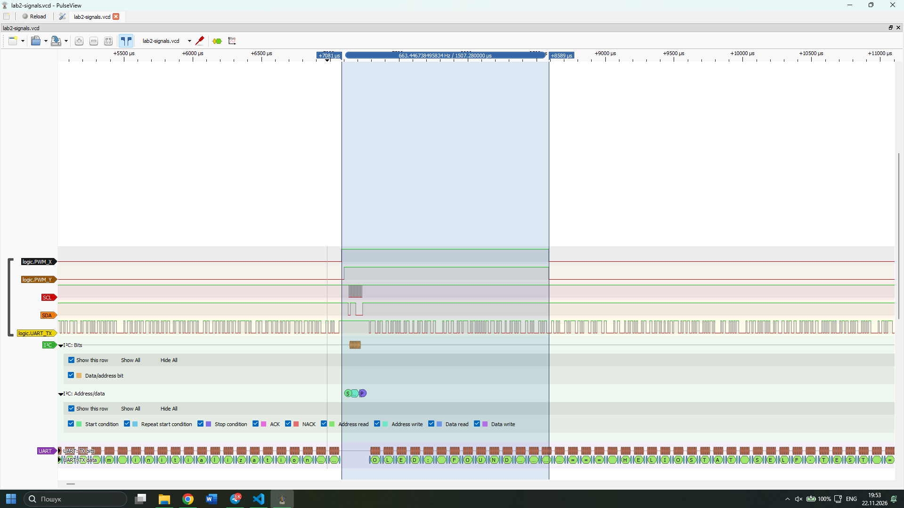
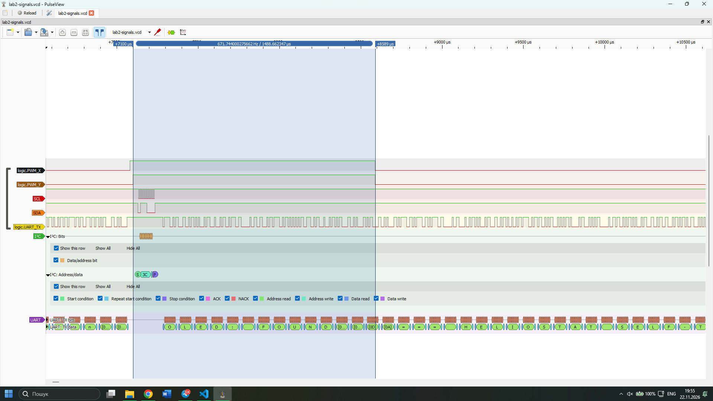
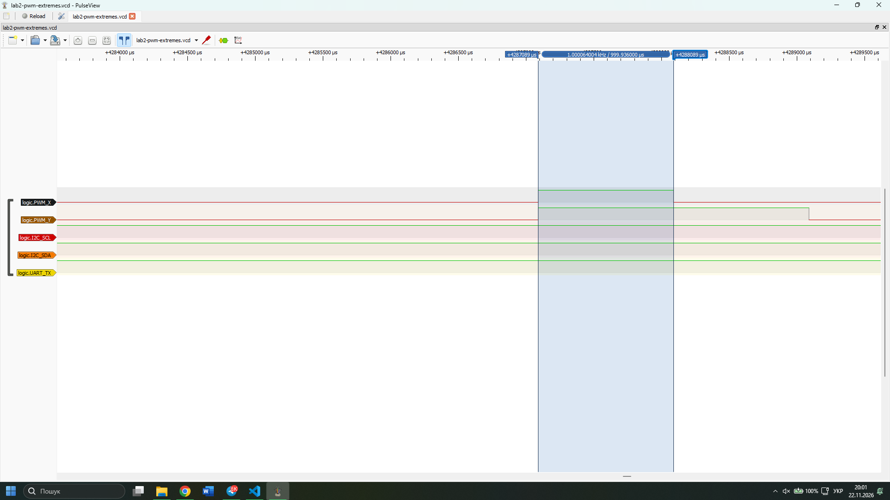
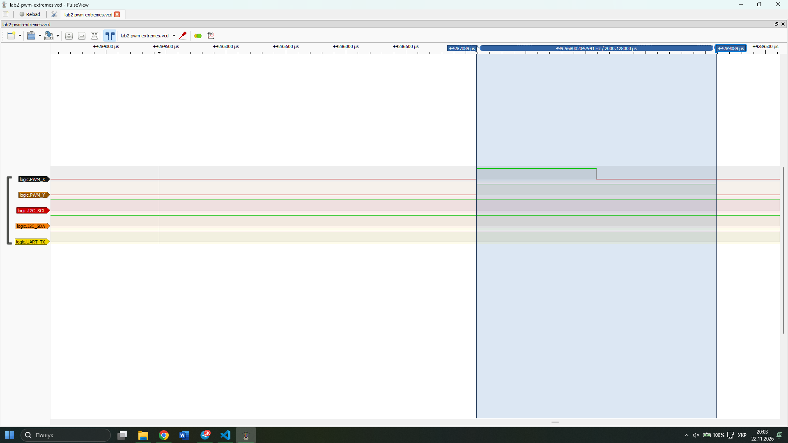

# Лабораторна робота №2

**Тема:** Інтеграція сенсорної підсистеми: схема підключення, верифікація інтерфейсів логічним аналізатором, архітектура програмного проєкту  
**Виконав:** Гаврилюк Артем Антонович, група ІО-31  
**Проєкт:** STM32 Heliostat  
**Платформа:** NUCLEO-C031C6 (STM32C031C6), Wokwi, STM32 HAL, Docker, GCC, PulseView

## 1. Мета роботи

Інтегрувати периферійні пристрої в один проєкт STM32, документувати підключення та обмеження, підтвердити обмін даними через цифрові інтерфейси за допомогою логічного аналізатора, відокремити апаратну та прикладну логіку, реалізувати самоперевірку й автоматизоване тестування.

## 2. Склад системи та підключення

Геліостат використовує два потенціометри як імітатори вхідних аналогових сигналів, два сервоприводи для позиціювання, OLED SSD1306 на шині I²C та кнопку MODE для перемикання AUTO/STANDBY. У симуляції використано логічний аналізатор із п'ятьма каналами.

| Пристрій / сигнал | Контакт STM32 | Периферія / призначення | Канал аналізатора |
|---|---|---|---|
| Потенціометр X, SIG | PA0 | ADC1_IN0 | — |
| Потенціометр Y, SIG | PA1 | ADC1_IN1 | — |
| Серво X, PWM | PB4 | TIM3_CH1 | D0 / PWM_X |
| Серво Y, PWM | PB5 | TIM3_CH2 | D1 / PWM_Y |
| OLED SCL | PB8 | I2C1_SCL | D2 / I2C_SCL |
| OLED SDA | PB9 | I2C1_SDA | D3 / I2C_SDA |
| UART TX | PA2 | USART2_TX, 115200 8N1 | D4 / UART_TX |
| UART RX | PA3 | USART2_RX | — |
| MODE | PA8 | GPIO input, підтягування до живлення | — |

Потенціометри й OLED у схемі Wokwi живляться від 3,3 В, серво — від 5 В; усі пристрої мають спільну землю. Для реального обладнання необхідно окремо перевірити запас струму живлення сервоприводів. Повні електричні характеристики, альтернативні розводки та посилання на документацію наведені в [`docs/pinout.md`](pinout.md) та [`docs/hardware-components.md`](hardware-components.md).

## 3. Функціональність та початкова перевірка

Після запуску ініціалізуються GPIO, I²C1, USART2, ADC1 і TIM3; виконується калібрування ADC і запуск обох PWM-каналів. Самоперевірка виводить машинозчитувані UART-повідомлення, зокрема:

```text
SELFTEST,ADC_X,SAMPLE,2050
SELFTEST,ADC_Y,SAMPLE,2050
SELFTEST,PWM_X,STARTED
SELFTEST,PWM_Y,STARTED
SELFTEST,OLED,ACK
SELFTEST,BUTTON,LEVEL,1
SELFTEST,END
```

`SAMPLE` засвідчує отримання значення ADC; `STARTED` — виконання програмного запуску PWM; `ACK` — підтвердження адреси I²C. Ці результати не слід ототожнювати з повною апаратною діагностикою.



У режимі **AUTO** значення ADC перетворюються на керуючі імпульси сервоприводів. У **STANDBY** показники ADC оновлюються, але останні керуючі PWM-значення зберігаються.

## 4. Верифікація цифрових інтерфейсів

### 4.1. Умови та файли захоплення

Вимірювання отримано з цифрового логічного аналізатора Wokwi у форматі VCD та переглянуто в PulseView. Сигнали під'єднані до D0–D4 згідно з таблицею підключень.

Файли захоплення:
- [`docs/captures/lab2-signals.vcd`](captures/lab2-signals.vcd) — початкове захоплення PWM, I²C, UART;
- [`docs/captures/lab2-pwm-extremes.vcd`](captures/lab2-pwm-extremes.vcd) — крайні значення керування PWM;
- [`docs/captures/lab2-i2c-nack.vcd`](captures/lab2-i2c-nack.vcd) — експеримент із від'єднаною SDA OLED.

**Метадані захоплень для доповнення:** версія Wokwi: _[заповнити]_; часовий крок/роздільна здатність VCD: _[перевірити `$timescale` у файлі]_; загальна тривалість кожного захоплення: _[заповнити]_. Для VCD із симулятора коректніше документувати часову роздільність запису, а не вигадувати частоту дискретизації фізичного аналізатора.

### 4.2. I²C: успішна адресація OLED

У PulseView декодовано послідовність **START → 7-бітна адреса 0x3C (Write) → ACK → STOP**. ACK підтверджує, що пристрій відповів на адресу. Це **не** є доказом передачі даних зображення на дисплей.



**Ручна перевірка адресного байта.** Для адреси 0x3C (двійкове `0111100`) та біта запису R/W=0 на шині передається 8-бітний байт `01111000` = **0x78** (MSB first). Дев'ятий такт відповідає ACK: приймач утримує SDA на низькому рівні. Декодер PulseView відображає 7-бітну адресу як `3C`.

### 4.3. I²C: ін'єкція відмови NACK

Для контрольованого негативного сценарію тимчасово від'єднано SDA OLED у `diagram.json`. У PulseView отримано **START → 0x3C (Write) → NACK → STOP**. Відсутність ACK підтверджує, що пристрій не відповів на звернення. Після експерименту штатне підключення необхідно відновити й перевірити повторним запуском.



Реакція UART `OLED: NOT FOUND` / `SELFTEST,OLED,NO_ACK`: **[позначити як підтверджену тільки після фактичного спостереження]**.

### 4.4. UART

USART2_TX на PA2 декодовано з налаштуваннями **115200 бод, 8 біт даних, без парності, 1 стоп-біт (8N1)**. У захопленні розпізнано друковані символи й службові байти `0x0D` (CR) та `0x0A` (LF), які відповідають текстовому формату виводу діагностики.



### 4.5. PWM: TIM3_CH1 та TIM3_CH2

Для двох каналів PWM у PulseView курсорами виміряно період і ширини імпульсів за різних положень потенціометрів.

| Параметр | Очікувано | Виміряно | Примітка |
|---|---:|---:|---|
| Період PWM_X | 20 мс | 20,005584 мс | Початок одного імпульсу → початок наступного |
| Частота PWM_X | 50 Гц | ≈49,986 Гц | Обчислена з виміряного періоду |
| PWM_X, центр | 1500 мкс | 1507,280 мкс | Початкове положення |
| PWM_X, мінімум | 1000 мкс | 999,936 мкс | Після оновлення ADC в AUTO |
| PWM_Y, центр | 1500 мкс | 1488,662 мкс | Початкове положення |
| PWM_Y, максимум | 2000 мкс | 2000,128 мкс | Після оновлення ADC в AUTO |

При крайніх положеннях X/Y керуючі імпульси мають різну тривалість; отже, спільний TIM3 забезпечує незалежну зміну коефіцієнта заповнення для CH1 та CH2 при спільному періоді.











## 5. Програмна архітектура

Проєкт поділено на:

```text
Core/main.c
  ├── App/heliostat_logic.c     (режими, перетворення ADC на кути/PWM)
  ├── Devices/heliostat_devices.c (інтерфейси компонентів)
  │     └── Platform/platform_io.c (адаптер STM32 HAL)
  └── Platform/platform_io.c    (UART та апаратні операції)
                               └── Core/Drivers: STM32 HAL
```

`App` не використовує HAL та збирається хостовим GCC. `Devices` звертається до `Platform` і не містить прямих викликів HAL. `Core/main.c` залишає системну ініціалізацію та оркестрацію. Детальний опис — [`docs/architecture.md`](architecture.md). Обмеження імпортів перевіряються скриптом `tests/check_architecture.py` (`make arch-check`).

## 6. Тестування, покриття та CI

| Перевірка | Результат |
|---|---|
| `make test` | PASS: ADC conversion; PASS: AUTO mode; PASS: STANDBY mode |
| `make arch-check` | Першочергова пряма перевірка Python: `ARCHITECTURE CHECK PASSED`; правило Makefile слід перевірити окремо |
| `make build` | Успішна компіляція ARM, exit code 0 |
| `make coverage` | `COVERAGE CHECK PASSED` |
| Покриття **рядків App** | **35/38 = 92,11%** |
| Покриття **функцій App** | **6/6 = 100%** |
| Мінімальний поріг | **80% рядків App** |
| Покриття гілок | Не вимірювалося |
| GitHub Actions | Workflow підготовлений; **статус успіху перевірити на вкладці Actions** |

HTML-звіт генерується локально в `build/coverage/html/index.html`. Покриття 92,11% стосується тільки `App/Src/heliostat_logic.c`, а не всієї STM32-прошивки або драйверів.

## 7. Журнал проблем і виправлень

Нижче наведено **підтверджені** проблеми, які виникали в процесі роботи. Перш ніж подавати фінальну версію звіту, доповнити записами до щонайменше п'яти конкретних випадків, додати фактичні коміти, де вони були усунені, і не приписувати неіснуючих змін.

| № | Симптом | Причина | Виправлення / доказ | Коміт |
|---|---|---|---|---|
| 1 | Хостові тести не компілювалися: `stdint.h`, `assert.h` not found | У Docker бракувало стандартних C-заголовків для GCC | Додано `libc6-dev`; повторний запуск тестів — `ALL TESTS PASSED` | [уточнити] |
| 2 | `make arch-check`: `No rule to make target` | Не було цілі `arch-check` у Makefile | Додати ціль та перевірити її локальний запуск | [уточнити] |
| 3 | При вимірюванні крайнього PWM спочатку залишалося ≈1,5 мс | Курсори стояли на ≈7 мс симуляції до першого оновлення PWM | Перенесено вимірювання після 1 с: PWM_X ≈999,936 мкс | Зміна процедури вимірювання, без коміту прошивки |
| 4 | OLED не відповідав на адресацію під час негативного тесту | Навмисне від'єднання SDA | Декодовано NACK; підключення слід відновити | Тестовий сценарій, без постійного коміту |
| 5 | **[Додати реальну проблему]** | **[Причина]** | **[Виправлення / перевірка]** | **[SHA]** |

## 8. Висновки

У межах роботи інтегровано аналогові входи, PWM-приводи, I²C OLED та UART-діагностику геліостата. Застосовано шарувату організацію `App`, `Devices`, `Platform`, `Core/Drivers`. Зафіксовано позитивну та негативну реакцію I²C на адресу 0x3C, декодовано UART 115200 8N1, виміряно ширини PWM від приблизно 1 до 2 мс і частоту близько 50 Гц.

Автоматичні тести прикладної логіки виконуються на GCC без STM32 HAL. Покриття рядків `heliostat_logic.c` становить 92,11% і перевищує заданий поріг 80%. Для остаточного завершення потрібні підтвердження статусу GitHub Actions, остаточна перевірка схеми після NACK-експерименту, повний журнал проблем із комітами, метадані VCD, додаткові тести драйверів і демонстраційний відеозапис.

## 9. Матеріали для захисту

- Репозиторій: https://github.com/Eshk3rensk1y/LR1-Heliostat
- Робоча гілка: `feat/lab2-sensor-integration`
- Pull Request до `main`: **[додати URL після створення]**
- Тег фінального коміту: `lab2` **[створити після завершення і злиття]**
- Демонстраційне відео 2–3 хв: **[додати посилання або шлях]**

